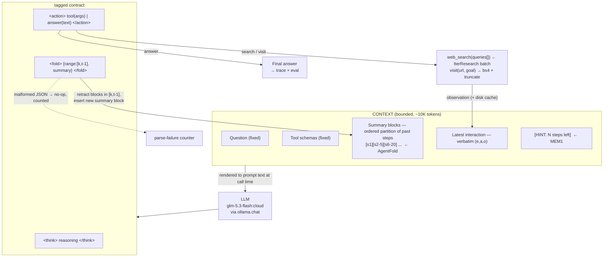

# fold-agent DESIGN

Grounded in the three source papers (fetched and read in full, not from the
roadmap summary): **AgentFold** (arXiv:2510.24699), **IterResearch**
(arXiv:2511.07327), **MEM1** (arXiv:2506.15841).

## What the papers establish (and what we take from each)

| Paper | Mechanism | We take | We skip |
|---|---|---|---|
| AgentFold | Context = (question, tools, multi-scale summary blocks, latest interaction verbatim). Each step emits a fold directive `{"range":[k,t-1],"summary":"..."}`: granular condensation (k=t-1) or deep consolidation (k<t-1). Blocks always form an ordered partition of past steps | The whole Phase-F mechanism; block-list context; context-vs-steps and block-count-vs-steps plots | Their SFT training (they needed it because *unreliable structured output*, not because folding needs training) |
| IterResearch | State = (question, evolving report, last interaction). Model rewrites the report every step; history discarded entirely; O(1) context; scales to 2048 interactions | Phase-L evolving report; batch search schema; goal-conditioned visit; §4.5's license (below) | EAPO/RL training |
| MEM1 | RL-trained consolidation into ONE internal state; rollout replaces context every turn | Rollout algorithm (their Alg. 1 is plain Python); turns-left hint; multi-objective eval (semicolon EM); metrics suite (EM, F1, peak tokens via approximate tokenizer) | RL, masked trajectories (training-only machinery) |

**The license for prompt-only:** IterResearch §4.5 — *without any training*, their
paradigm beats ReAct by +12.7–19.2pp on BrowseComp when applied to o3 and
DeepSeek-V3.1 as a prompting strategy. That is the evidence our untrained
build rests on.

**The honest caveat:** AgentFold §3.4 — even frontier LLMs "cannot reliably
produce AgentFold's structured, multi-part responses through prompt engineering
alone." They solved it with rejection sampling + SFT; we solve it by (a) keeping
the fold directive tiny (one JSON line inside tags, not a four-part quadruplet),
(b) treating malformed folds as no-ops, (c) **counting parse failures as a
first-class eval metric**. If parse failures dominate, the fix is model swap,
not architecture.

Convergent-evolution note for the README: IterResearch's appendix points out
AlphaEvolve independently arrived at (task, evolving report, immediate context)
for algorithm discovery. Two unrelated domains, same workspace shape.

## Architecture (Phase F target)

Baseline (Phase B) = same loop, zero folding: every step appended verbatim.
To view: push to GitHub (renders natively) or VS Code with a Mermaid preview extension.

## Stack decisions (each forced by a paper)

1. **Plain Python, no framework.** MEM1's Algorithm 1 and IterResearch's
   Algorithm 1 are both ~20-line while loops. crewai is not invited.
2. **LLM: `glm-5.3-flash:cloud` via `ollama.chat`** (never `/api/generate` —
   returns empty on this model, verified). Single `MODEL` constant in `llm.py`
   is the swap seam if structured-output compliance disappoints.
3. **Output contract: XML-style tags + one-line JSON fold.** Tagged sections
   (`<think>/<fold>/<action>`) parse far more reliably than whole-response
   JSON; regex parser; malformed fold → treated as granular no-op, counted.
4. **Context as data, not string.** `blocks: list[(start, end, text)]`
   partitioning steps 1..t-2 (AgentFold formalism §3.2). Folding = retract
   blocks intersecting [k, t-1], insert one new block. Rendered to prompt
   text only at call time.
5. **Turns-left hint every step** (MEM1): `[HINT: N steps left]` — folding
   removes history, so termination awareness must come from code, not memory.
6. **Tools:** `web_search(queries: list[str])` batch (IterResearch schema —
   fewer turns per sub-question), `visit(url, goal)` = requests + bs4 extract
   + truncate v1; goal-conditioned LLM digest is a v1.5 upgrade (what
   IterResearch does natively). MEM1's snippets-only evidence says HotpotQA
   answers don't require deep page reads.
7. **Search infra: DDGS + disk cache on both tools** (gitignored `cache/`,
   keyed by query-hash / url-hash). Papers used SerpAPI/Google (paid); our
   eval reruns × ablations demand caching instead.
8. **Eval: HotpotQA dev, 20 questions.** Metrics exactly MEM1's suite: EM +
   word-level F1 (their formula), peak context tokens via tiktoken cl100k
   (MEM1 used GPT-4o-mini's tokenizer — same approximation class, stated in
   eval), steps, parse-failure count. Plots: context-vs-steps and
   block-count-vs-steps (AgentFold Fig. 3a/3b). Phase L: multi-objective —
   4–8 questions concatenated, semicolon-separated answers, per-answer EM
   (MEM1 §3.3).
9. **Budgets:** single-objective max 20 steps; multi-objective max 64.
   (MEM1 trains ≤20; AgentFold allows 100; IterResearch trains 32, evals
   256. We sit in the middle and it's a constant, not a law.)
10. **Token counting: tiktoken (cl100k), marked approximate.** Relative
    comparisons across arms are self-consistent; that's what the claims need.

## Failure modes (named in advance)

- Malformed fold JSON → no-op + counted; if rate >20% of steps, swap model
- Dead-end loops (same query repeated) → repeated-query detection in code +
  deep-consolidation prompt hint (AgentFold's case study is exactly this)
- Empty DDGS results ≠ failure → "no results" is distinct from
  "search failed: ..." (news-agent lesson)
- Multi-objective answer drift → semicolon format enforced in prompt, scored
  per sub-answer; wrong count = partial credit, never all-or-nothing
- Eval contamination by live web drift → cache freezes the environment;
  baseline and folded arms run against identical cached observations
