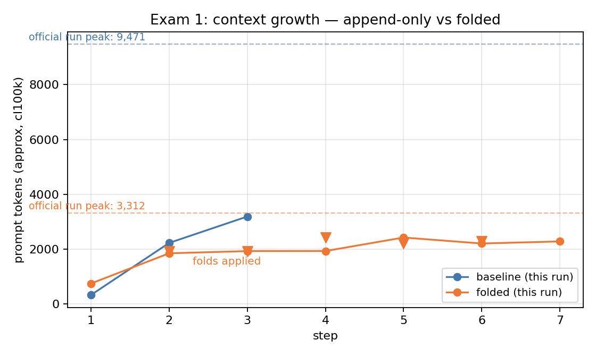
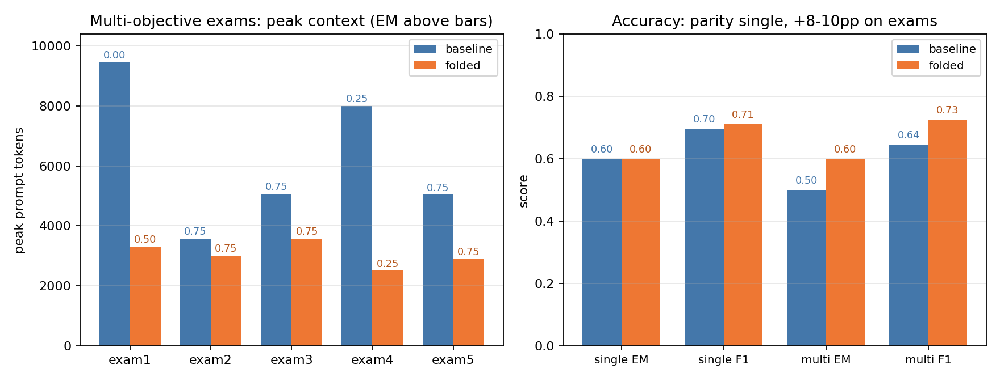

# fold-agent

A long-horizon research agent that **folds its own context** while it works —
the agent decides, every turn, which of its past steps to compress into a
summary, keeping its context window flat while answering multi-question
research tasks.

Built from scratch (no agent framework) to test one idea from the literature
in miniature: [AgentFold](https://arxiv.org/abs/2510.24699)'s context
folding + [IterResearch](https://arxiv.org/abs/2511.07327)'s evolving report
+ [MEM1](https://arxiv.org/abs/2506.15841)'s multi-objective protocol,
run untrained (pure prompting) on a small model (GLM flash via Ollama).

## The result

5 exams × 4 HotpotQA questions each, one continuous run per exam:



| arm | EM (per-part) | F1 | avg peak tokens | format errors |
|---|---|---|---|---|
| baseline (append-only ReAct) | 0.50 | 0.64 | 6,232 | 1 |
| report only (no folding) | 0.60 | 0.69 | 6,675 | 3 |
| fold only (no report) | 0.65 | 0.76 | 4,323 | 5 |
| **fold + report** | **0.65** | **0.76** | **3,227** | **3** |



Three findings:

1. **Attribution is clean** — the report is the accuracy mechanism
   (+10pp EM over baseline at *higher* token cost); folding is the context
   mechanism (−48% peak). Neither alone gives both.
2. **The naive agent drowns**: on exam 1 the baseline peaked at 9,471
   tokens and scored 0/4 exact; the folding agent scored 2/4 at 3,312.
   Reproduced on re-run.
3. **Format reliability was the bottleneck, not memory**: shrinking the
   prompt's worked examples 2→1 plus a tag checklist cut format errors
   26% → 8% while accuracy rose.

## How it works

Each turn the model outputs four tagged sections:

```
<reasoning>why this action next</reasoning>
<fold>{"range": [2, 4], "summary": "Q1 answered: Istanbul; Mencken = journalist..."}</fold>
<report>Q1: Istanbul (done)  Q2: pending - ...  Q3: ...</report>
<action>web_search(["albert camus profession"])</action>
```

- History is an ordered partition of blocks `[steps k–t]`. A fold retracts
  every block intersecting `[k, t-1]` and inserts one summary block (exact
  span union — the partition never develops gaps or overlaps; 200 randomized
  trials in the repo's history).
- The `<report>` (one line per question) rides in the prompt every step —
  durable memory while raw history is folded away behind it.
- Context is **rebuilt from blocks every step**, never appended.

## Run it

```bash
# deps: pip install ollama duckduckgo-search beautifulsoup4 tiktoken matplotlib; ollama serving a model
python agent.py            # smoke: 3-question exam
python run.py              # single question, trace written to traces/
python eval.py folded      # 20 single questions, folded arm
python eval.py multi fixed # 5 exams × 4 questions, folding agent
python plots.py            # regenerate figures from committed results
```

`DESIGN.md` has the paper analysis and 10 evidence-forced design decisions;
`eval.md` has all 9 findings with honest caveats; `PLAN.md` is the build log.

## Honest caveats

- n=5 exams (20 questions total): differences under ~15pp are noise; the
  exam-1 drowning reproduced once, not twice.
- Token counts are cl100k approximations for a different model — valid for
  relative comparison only.
- Single 2-hop questions show *no* folding benefit (nothing to compress at
  step 4) — parity there is the safety check, the gains live at horizon.
